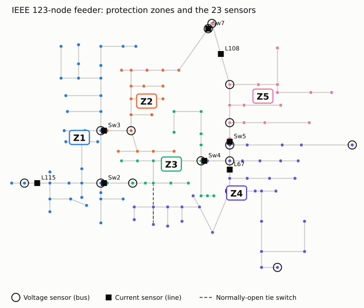
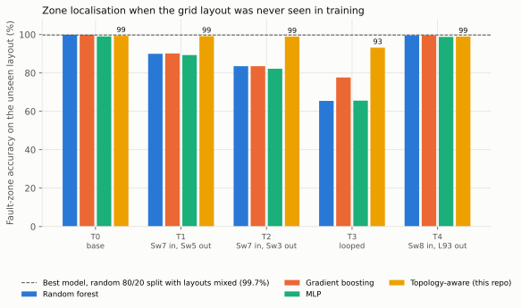
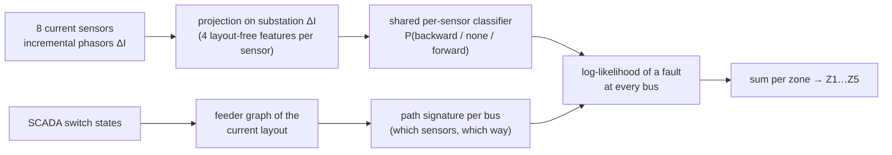
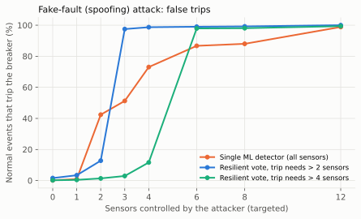
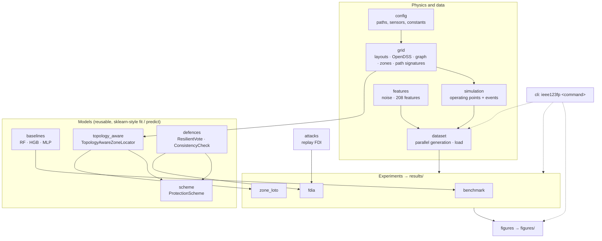

# ML fault protection on the IEEE 123-node feeder: unseen grid layouts and false-data attacks

[](https://github.com/red-snow/ieee123-ml-fault-protection/actions/workflows/ci.yml)


Machine-learning fault detection, fault-type classification and fault-zone localisation on the
IEEE 123-node distribution test feeder (OpenDSS). The models are tested in the two settings that
matter for real adaptive protection:

1. **Grid layouts the model never saw.** Utilities reconfigure feeders by opening and closing
   switches. Every model is tested leave-one-topology-out (LOTO): it is trained on four layouts and
   tested on a fifth that it has never seen.
2. **False data injection.** An attacker who controls some sensors replays recorded data, either
   to hide a real fault or to fake one.



## Results at a glance

| Question | Standard ML (best of 3 models) | This repo |
|---|---|---|
| Is there a fault? (unseen layout, mean of 5) | 99.6 % accuracy | – |
| What type of fault? (unseen layout, mean) | 99.8 % accuracy | – |
| Which zone? (layouts mixed, random 80/20 split) | 99.7 % | – |
| **Which zone? (unseen layout, mean / worst)** | **90.1 % / 77.6 %** | **97.9 % / 93.2 %** (topology-aware) |
| **False trips when an attacker controls the 3 most relied-on sensors** | **51.3 %** | **2.9 %** (resilient vote, trip needs > 4 sensors) |

The two headline findings:

- **Zone localisation is the weak spot of black-box ML.** It looks almost perfect (99.7 %) on
  the usual random test split. On a layout it never saw, it drops to 65–78 % on the looped grid,
  for all three model types. A **topology-aware model** fixes most of this, because it gets
  the current switch states from SCADA instead of memorising one layout: 97.9 % on average and
  ≥ 98.9 % on every radial layout.
- **A single ML detector is easy to fool with fake fault data.** Replaying a recorded fault on
  just 2 sensors causes false trips 42 % of the time. **f-resilient voting**, modelled on the
  W-MSR idea from cyber-secure microgrid control, cuts that to 1.4 %. It still catches 99.6 % of
  real faults.

All numbers come from `results/*.csv` and are reproduced bit-for-bit by `ieee123fp all`.

**Contents:** [Quick start](#quick-start) · [The idea](#the-idea-in-plain-words) ·
[Study design](#study-design) · [Result 1](#result-1-detection-and-fault-type-generalise-zone-does-not) ·
[Result 2](#result-2-topology-aware-zone-localisation) · [Result 3](#result-3-false-data-injection) ·
[Architecture](#architecture) · [Python API](#using-it-as-a-library) · [Extending](#extending-the-study) ·
[Reproducibility](#reproducibility) · [Limitations](#limitations)

---

## Quick start

```bash
git clone https://github.com/red-snow/ieee123-ml-fault-protection.git
cd ieee123-ml-fault-protection
pip install -e ".[dev]"          # installs the `ieee123fp` command
```

```bash
ieee123fp fetch                  # download the IEEE 123-node OpenDSS model (pinned, SHA-256 checked)
ieee123fp all --quick            # ~1 min smoke run on 1,000 events; writes only under data/quick/
ieee123fp all                    # the full study: 30,000 events, ~7 min on 4 cores (~20 min on 2)
pytest -m "not slow"             # fast checks (~2 s); plain `pytest` adds the end-to-end smoke test (~1 min)
```

Each stage can also run on its own; every command accepts `--data`, `--results` and `--figures`
to point it somewhere else:

| Command | What it does | Writes | Time (4 cores) |
|---|---|---|---|
| `ieee123fp fetch` | download the feeder model | `feeder/` | seconds |
| `ieee123fp generate` | simulate 5 layouts × 6,000 events | `data/raw_phasors.npz`, `data/raw_phasors_meta.csv` (~60 MB, not committed) | ~30 s |
| `ieee123fp benchmark` | black-box detection / type / zone, random split vs LOTO | `results/metrics.csv`, `summary.json` | ~4.5 min |
| `ieee123fp zone` | topology-aware zone localisation, LOTO | `results/metrics_topology_aware.csv`, `topology_aware_sensor_acc.json` | ~15 s |
| `ieee123fp fdia` | false-data-injection study and defences | `results/fdia*.csv`, `fdia_sensor_ranking.json` | ~1.5 min |
| `ieee123fp figures` | SVG figures from saved results (no retraining) | `figures/*.svg` | seconds |

`bash run_all.sh` is kept as a shortcut for `ieee123fp all` and works without installing the package.

## The idea in plain words

A distribution feeder is a tree of power lines that carries electricity from a substation to
homes and businesses. When a line touches the ground or another line (a **fault**), huge currents
flow, and protection devices must open the right breaker within a fraction of a second.

Protection settings are traditionally fixed. Modern feeders keep changing, though: rooftop solar
adds new power sources, and operators open and close switches to reroute power (a **new layout**
or **topology**). ML promises protection that adapts. But an ML model that learned one layout can
be quietly wrong on another, and a model that trusts its sensors can be fooled by fake data.

This project measures both problems on a standard test grid and tries a physics-guided fix for each.

## Study design

**Grid.** IEEE 123-node test feeder, 4.16 kV, built from EPRI's OpenDSS model. The source strength
is set to 200 MVA (three-phase short circuit), which gives realistic fault currents.

**Five layouts** (all keep every bus powered; checked in `tests/`):

| Layout | Switching | What changes |
|---|---|---|
| T0 | standard IEEE configuration | – |
| T1 | close tie Sw7, open Sw5 | zone Z5 is fed from the Z2 side |
| T2 | close tie Sw7, open Sw3 | zone Z2 is fed backwards through Z5 |
| T3 | close tie Sw7 | the feeder becomes a **loop** (two paths to many buses) |
| T4 | close single-phase tie Sw8, open L93 | bus 94 is fed from bus 54 |

**Sensors (the same hardware in every layout).** 15 three-phase voltage sensors on buses and 8
three-phase current sensors on lines, like micro-PMUs or numerical relays. Readings get 0.5 %
magnitude noise and 0.2° angle noise.

**Events (30,000 samples, 6,000 per layout).** Each sample randomises:
- load level (40–120 %, ±10 % per load);
- rooftop/feeder solar (0–60 % of load, at 1–5 sites, in 70 % of samples);
- the state of the 600 kvar capacitor.

Then one event happens:
- **Normal (20 %):** a load swing, capacitor switching or a large motor start. These are
  deliberately "fault-like" so they make a hard negative class.
- **Faults (80 %):** single-line-to-ground (SLG), line-to-line (LL), double-line-to-ground (LLG)
  or three-phase (LLL), at any 4.16 kV bus and on any available phases. Ground faults use 0.05–40 Ω
  and phase faults 0.01–3 Ω (log-uniform).

**Features (208).** Post-event phasors (magnitude, angle), the change in current from before the
event, and sequence components (V0/V1, V2/V1, I0, I2).

**Zones.** The five protection zones are fixed geographic sections bounded by switches Sw2–Sw5,
like a utility's protection map (see the figure above).

## Result 1: detection and fault type generalise; zone does not

Accuracy (%), 3 models, random 80/20 split vs. leave-one-topology-out (mean and worst of 5 held-out layouts):

| Task | Model | Random split | LOTO mean | LOTO worst |
|---|---|---|---|---|
| Detection | Random forest | 99.8 | 99.6 | 99.2 |
| Detection | Gradient boosting | 99.9 | 99.4 | 98.1 |
| Detection | MLP | 99.5 | 96.2 | 90.9 |
| Fault type | Random forest | 99.6 | 99.7 | 99.5 |
| Fault type | Gradient boosting | 99.8 | 99.8 | 99.8 |
| Fault type | MLP | 99.7 | 99.7 | 99.4 |
| **Zone** | Random forest | 99.5 | **87.7** | **65.4** |
| **Zone** | Gradient boosting | 99.7 | **90.1** | **77.6** |
| **Zone** | MLP | 98.5 | **87.0** | **65.6** |

Some details:
- The fault type comes from the pattern across phases, which looks the same in every layout, so it
  transfers.
- On unseen layouts the MLP raises more false alarms. Its security drops to 83.4 % against 99.5 % on
  the random split.
- Fault resistance matters only a little at this noise level. Gradient boosting detects 100 % of
  ground faults below 5 Ω and 99.0 % at 20–40 Ω.

**Why zone fails.** In T1, faults in zone Z5 now draw current through Z2's switch, and the model
calls 446 of 455 of them "Z2". It has memorised *which sensors light up* for each zone, and
reconfiguration changes exactly that. Giving the model the switch states as extra inputs does not
help (90.1 % → 90.1 % on T1; 80.8 % → 75.4 % on the loop, measured during development). The
held-out switch combination is still new to it.

## Result 2: topology-aware zone localisation



The method (`TopologyAwareZoneLocator` in `src/ieee123fp/models/topology_aware.py`) splits the
problem in two:

1. **A per-sensor ML model answers a local question that means the same thing in every layout:**
   "Is fault current flowing through me, and in which direction?" (forward, backward or none). It
   sees only its own sensor's incremental current, projected onto the substation's incremental
   current. This is the polarising idea a directional relay uses.
2. **The current grid graph decodes the answers into a zone.** The switch states are known to the
   utility's SCADA. For every bus, the graph tells us which sensors sit on the path(s) from the
   substation, and in which direction the current crosses them (`grid.path_signatures`). The zone
   whose buses best explain the sensors' answers wins (a likelihood over buses, summed per zone).



Two physics facts are added as training data, which matters because they never appear in the
training layouts:

- **Direction symmetry.** A sensor read backwards sees every current rotated 180°, and the label
  flips. Without this, sensors that never carried reversed current in training (Sw4, Sw5) cannot
  recognise it in the loop.
- **Current division.** In a loop, fault current splits over two paths, so an on-path sensor may
  carry only part of it. Training rows are scaled by a random factor (0.05–1) with labels unchanged.

Result on the unseen layout: **T0 99.3 %, T1 99.1 %, T2 98.9 %, T3 (loop) 93.2 %, T4 99.0 %**. The
best black-box model scored 99.9 / 90.1 / 83.5 / 77.6 / 99.6 %.

**What did not work (kept for honesty).** Loop (T3) accuracy of each variant, measured during
development on the same 30,000 events in an earlier row order:

| Variant | Loop zone accuracy |
|---|---|
| Path membership only (no direction) | 53.6 % |
| + direction, with raw magnitudes/angles as inputs | 69.6 % |
| + direction symmetry augmentation | 74.6 % |
| Direction as angle ratio per phase (blew up on un-faulted phases) | 35.3 % |
| Projection features without current-division augmentation | 25.3 % |
| **Projection features + both augmentations (final)** | **93.3 % (93.2 % in the final run)** |

In the same development run, a plain physics rule on the projection (sign if |projection| > 0.05)
got 97.9 % of per-sensor directions right in the loop. Models that see the raw readings did *worse*
than that rule, because they latch onto layout-specific patterns. Keeping the inputs physical is
what makes the model transfer.

## Result 3: false-data injection



**Threat model.** The attacker controls k of the 23 sensor data streams and replays real recorded
data (`src/ieee123fp/attacks.py`):
- **masking:** during a real fault, report pre-fault readings, to hide the fault;
- **spoofing:** during normal operation, replay readings recorded during a fault, to cause a false
  trip.

The *targeted* attacker picks the sensors the detector relies on most.

**Findings** (`results/fdia.csv`, gradient-boosting detector trained on all sensors):
- **Masking is hard.** A fault shows on many sensors at once. Even with 12 random sensors
  compromised, 97.8 % of faults are still detected.
- **Spoofing is easy.** With 2 targeted sensors, 42 % of normal events trip. With 3, 51 %.
- **A first defence failed.** It predicted every sensor from all the others and repaired the
  inconsistent ones. This doesn't help: two or more compromised sensors back each other up. It
  also flags 8.3 % of clean events.

**Defence that works: f-resilient voting** (`ResilientVote` in `src/ieee123fp/models/defences.py`).
Each sensor gets its own small detector, set like a relay to fire on at most 1 % of normal events.
The breaker trips only if more than f sensors independently say "fault". An attacker controlling
≤ f sensors then cannot trip the breaker alone. To hide a fault, they need it to be visible to fewer
than 2f + 1 honest sensors. This is the same "discard up to f extreme neighbours" logic as W-MSR,
used for cyber-secure distributed control of microgrids.

| Targeted sensors k | Single detector: false trips | Vote f = 3 | Vote f = 4 |
|---|---|---|---|
| 0 (no attack) | 0.2 % | 0.4 % | 0.2 % |
| 2 | 42.4 % | 3.2 % | 1.4 % |
| 3 | 51.3 % | 12.5 % | 2.9 % |
| 4 | 73.0 % | 98.0 % | 11.7 % |

Faults detected with vote f = 4: 99.7 % with no attack (99.98 % for the single detector). The
design choice is f: a higher f buys security against more compromised sensors and costs
sensitivity to faults that only a few sensors can see. Once the attacker controls more than f
sensors, voting gives no protection. That is the honest limit of the scheme.

---

## Architecture

The code is an installable package, `ieee123fp`, in strict layers: each module only imports from
the ones above it, so the grid model knows nothing about ML and the models know nothing about
file paths.



```
src/ieee123fp/
├── config.py            paths (Paths.default / Paths.quick), sensor lists, event and noise constants
├── grid.py              Topology dataclass + the 5 layouts, compile_feeder, feeder_graph,
│                        compute_zones, path_signatures (one graph builder shared by everything)
├── simulation.py        Simulator: random operating point → pre-event / post-event phasors
├── features.py          measurement noise, 208-feature vector, per-sensor column map
├── dataset.py           seeded parallel generation; load() → Dataset(X, meta, ph)
├── feeder.py            download of the pinned OpenDSS model with SHA-256 checks
├── attacks.py           replay masking / spoofing, random vs targeted attacker
├── models/
│   ├── baselines.py     black-box model zoo + dependability / security metrics
│   ├── topology_aware.py  local direction features + TopologyAwareZoneLocator
│   ├── defences.py      ResilientVote (works), ConsistencyCheck (does not; kept for the record)
│   └── scheme.py        ProtectionScheme: secure trip → fault type → zone for the live layout
├── experiments/
│   ├── benchmark.py     Result 1: random split vs leave-one-topology-out
│   ├── zone_loto.py     Result 2: topology-aware zone localisation
│   └── fdia.py          Result 3: false-data injection and defences
├── figures.py           README figures from saved results
└── cli.py               `ieee123fp` command (also `python -m ieee123fp`)
tests/                   unit + OpenDSS checks (test_units, test_grid), and an end-to-end smoke run (`-m slow`)
feeder/                  fetch_feeder.sh (wrapper); downloaded model files are not committed
results/  figures/       committed outputs of the full run
```

Design decisions:

- **Topology is data, not strings.** A layout is a `Topology(name, close={...}, open=(...))`.
  The OpenDSS commands, the set of opened lines and the graph all derive from it, so adding a
  layout is one line.
- **One graph builder.** The zone map, the path signatures and the feeder figure all come from
  `grid.feeder_graph`, so they cannot disagree.
- **Models are separated from experiments.** `TopologyAwareZoneLocator`, `ResilientVote` and
  `ProtectionScheme` are plain `fit` / `predict` objects that can be reused outside the study; the
  experiment modules only wire data splits to models and write results.
- **Deterministic by construction.** Simulation seeds depend only on (layout, chunk), never on the
  number of worker processes; noise, splits and models use fixed seeds.
- **Smoke runs never touch committed results.** `--quick` writes under `data/quick/` (git-ignored).

## Using it as a library

```python
from ieee123fp.dataset import load
from ieee123fp.models import ProtectionScheme, TopologyAwareZoneLocator

ds = load()                                   # 30,000 events: ds.X (n, 208), ds.meta, ds.ph (phasors)

# End-to-end scheme: f-resilient trip decision, fault type, zone for the layout the grid is in now.
# (Fitted on every event here, so the decisions below are in-sample: an illustration, not a result.)
scheme = ProtectionScheme(f=4).fit(ds)
loop = ds.subset((ds.meta.topo == "T3_loop").values)
scheme.decide(loop.X[:5], {k: v[:5] for k, v in loop.ph.items()}, topo="T3_loop")
#    votes   trip ftype  zone  zone_conf
# 0     23   True    LL    Z2        1.0
# 1     23   True   LLL    Z4        1.0
# 2      0  False  NONE  NONE        NaN
# ...

# The zone locator on its own, trained on four layouts and decoded on the unseen fifth
faults = ds.faults()
train, test = (faults.subset((faults.meta.topo != "T3_loop").values),
               faults.subset((faults.meta.topo == "T3_loop").values))
loc = TopologyAwareZoneLocator().fit(train.X, train.ph, train.meta.topo.values, train.meta.bus.values)
(loc.predict(test.X, test.ph, topo="T3_loop") == test.meta.zone.values).mean()   # 0.932
```

## Extending the study

- **A new layout:** add a `Topology(...)` to `_LAYOUTS` in `grid.py`, run `pytest` (it checks that
  every layout converges and energises every bus), then `ieee123fp all`. LOTO loops pick it up.
- **Different sensors:** edit `V_SENSORS` / `I_SENSORS` in `config.py`. Feature columns, attacks and
  the per-sensor voters follow automatically. Regenerate the data.
- **A new black-box model:** add a factory to `model_zoo()` in `models/baselines.py` and a label to
  `MODEL_LABELS`; the benchmark and the zone figure include it.
- **Different noise or event mix:** `config.py` (`NOISE_*`, `CLASS_WEIGHTS`, `RF_RANGE`).

## Reproducibility

- The feeder model is downloaded from a pinned commit and every file is SHA-256 checked.
- `ieee123fp all` reproduces every committed file in `results/` exactly (only the `secs` timing
  column of `metrics.csv` differs), checked with the pinned `scikit-learn==1.9.1` and
  `opendssdirect.py==0.9.4` on Python 3.13.
- The raw dataset (`data/`, ~60 MB) is not committed; `ieee123fp generate` recreates it exactly.
- CI (`.github/workflows/ci.yml`) runs lint, the fast tests and the end-to-end smoke test on every push.

## Limitations

- **Phasor snapshots, not waveforms.** OpenDSS steady-state fault studies stand in for what a relay
  sees one or two cycles after fault inception. No transients, CT saturation or decaying DC offset.
- **Solar is simplified.** It is modelled as generators that inject constant power and switch to a
  constant impedance at low voltage. Real grid-following inverters limit fault current to about
  1.1–1.5 pu and have their own control dynamics, which reduces fault-current contribution and
  makes detection harder.
- **Sensors are idealised.** They are perfectly time-synchronised and have fixed placement.
- **Simple attacker.** It replays recorded data; there are no optimisation-based stealthy attacks.
- **Simulation only.** Results need hardware-in-the-loop validation (e.g. OPAL-RT with real relays
  and IEC 61850 GOOSE/Sampled Values traffic).

## Next steps

- Electromagnetic-transient data (PSCAD/EMTP or OPAL-RT) and time-series models on raw waveforms.
- Current-limited inverter models and higher solar penetration.
- Attacks at the protocol level: GOOSE/SV spoofing on an IEC 61850 testbed.
- A compact on-device model on embedded hardware (e.g. NVIDIA Jetson with TensorRT) and its
  decision latency.
- Graph neural networks with the physics-informed inputs used here.

## Author

**Farman Ullah Khan**: MS Computer Engineering (COMSATS University Islamabad), certified ethical
hacker and penetration tester, embedded AI engineer. My MS thesis is on subject-independent deep
learning for physiological time series. The leave-one-subject-out testing used there is the reason
this project tests leave-one-*topology*-out.

Feeder model: IEEE PES Distribution Test Feeders / EPRI OpenDSS (BSD licence).
Code: MIT licence.
